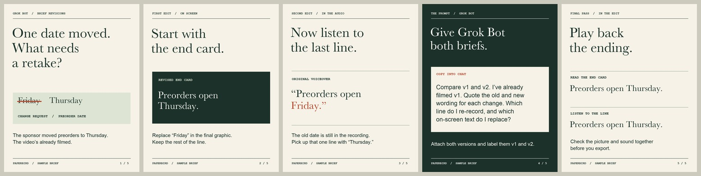

# One date moved. What needs a retake?

A five-card before-and-after carousel for creators editing a sponsor video. The Paperbird briefs are fictional. The example quotes the two files and includes a prompt you can try in Grok Bot. The depicted copy comes directly from the briefs.

**Swipe files in order:** [1 · Cover](01.png) · [2 · End card](02.png) · [3 · Voiceover](03.png) · [4 · Prompt](04.png) · [5 · Playback](05.png)

## Ask CarouselCraft to make it

> Make a five-card before-and-after carousel for a creator who has already filmed a sponsor video. Use the two attached Paperbird briefs. Open with the changed date, show the end-card and voiceover edits on separate cards, give me a prompt to reuse in Grok Bot and close with a playback check. Give each card its exact words and a layout direction. Keep the supplied wording for both versions of the preorder line.

Attach the [original brief](paperbird-brief-v1.txt) and [revised brief](paperbird-brief-v2.txt).

## Prompt for each visual

Use portrait 4:5 throughout, with an ivory page, dark green ink, a serif headline and a sans-serif body. Set dates, quotations and prompts as editable text. The directions below describe layouts you can recreate in a slide editor.

| Card | Headline | Layout direction |
| --- | --- | --- |
| 1 | One date moved. What needs a retake? | Place the headline above a pale green change slip. Typeset Friday and Thursday beside each other. Strike out Friday once in rust. |
| 2 | Start with the end card. | Put “Preorders open Thursday.” inside a dark inset frame. Leave enough space for the viewer to read the revised line in one glance. |
| 3 | Now listen to the last line. | Show the old spoken line as a large quotation. Set “Friday” on its own line in rust, with an explicit original-voiceover label. |
| 4 | Give Grok Bot both briefs. | Reverse the page to dark green. Put the prompt below on a light rectangle in large type, followed by a short note about attaching both files. |
| 5 | Play back the ending. | Stack two aligned rows labelled “Read the end card” and “Listen to the line”. Put the same exact revised sentence under each. |

**Grok Bot prompt printed on card 4**

> Compare v1 and v2. I’ve already filmed v1. Quote the old and new wording for each change. Which line do I re-record, and which on-screen text do I replace?

**Post caption**

The revised brief says Thursday. The old voiceover still says Friday. Here are the two places to check before the video goes out, plus the prompt to try with your own revisions.
